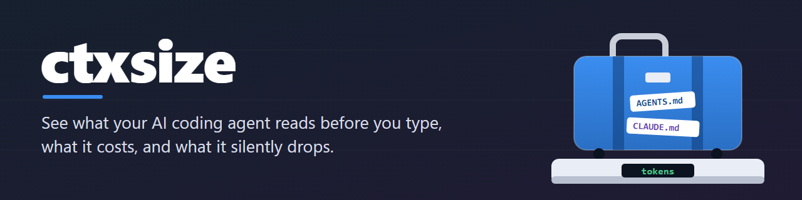
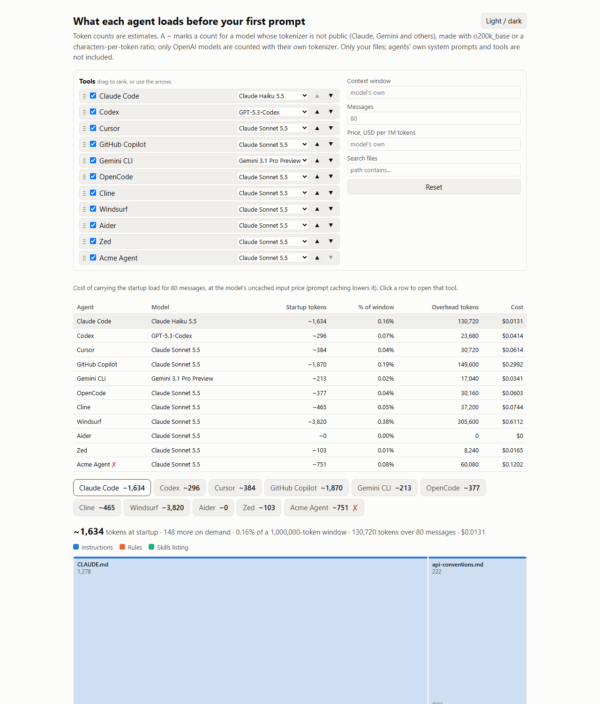
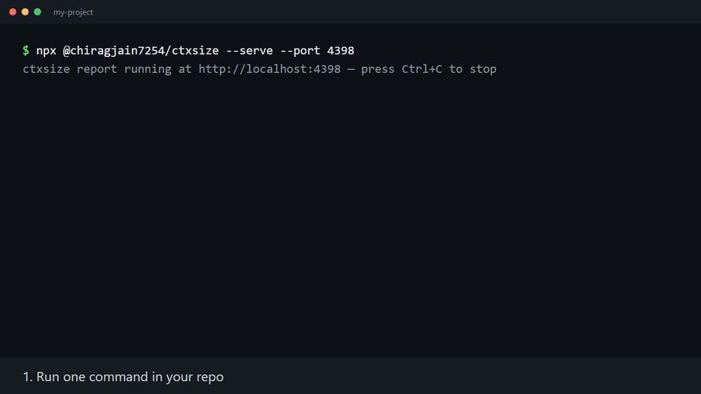

<div align="center">



<p><b>See what your AI coding agent reads before you type, what it costs, and what it silently drops.</b></p>

<p>
<a href="https://www.npmjs.com/package/@chiragjain7254/ctxsize"></a>
<a href="https://www.npmjs.com/package/@chiragjain7254/ctxsize"></a>
<a href="https://github.com/Chiragjain7254/ctxsize/actions/workflows/ci.yml"></a>
<a href="LICENSE"></a>
</p>

</div>

```sh
npx @chiragjain7254/ctxsize --serve
```

<picture>
  <source media="(prefers-color-scheme: dark)" srcset="docs/img/report-dark.png">
  
</picture>

## Sound familiar?

- You have both an `AGENTS.md` and a `CLAUDE.md`, and Claude Code reads only the `CLAUDE.md`. The `AGENTS.md` you wrote is skipped. ([source](docs/WHY.md#which-file-does-my-agent-read), [Claude Code docs](https://code.claude.com/docs/en/memory.md))
- Your `CLAUDE.md` is loaded at the start of every session and stays in the conversation, so a long one costs tokens on every message. Caching makes that cheaper, never free. ([Claude Code docs](https://code.claude.com/docs/en/memory.md), [source](docs/WHY.md#my-instruction-files-waste-tokens))
- Your `AGENTS.md` files add up to more than 32 KiB, and Codex stops reading at that limit. ([Codex docs](https://learn.chatgpt.com/docs/agent-configuration/agents-md), [source](docs/WHY.md#agents-silently-drop-or-ignore-files))
- The same paragraphs sit in two files that one agent reads, so you pay for them twice.

**ctxsize shows all of this in one command.**

## Why I built this

I kept wondering why my agent ignored instructions I'd written. Then I found [Claude Code issue #6235](https://github.com/anthropics/claude-code/issues/6235) asking for `AGENTS.md` support: 5,189 thumbs-up and 409 comments from developers with the same confusion (checked on 2026-10-16; it was closed in August 2026, and Claude Code now reads `AGENTS.md` when there is no `CLAUDE.md`). Others wrote about instruction files that are processed again on every turn ([an example](https://vantaige.io/blog/claude-code-token-waste-9-patterns-fixes-2026)), and about files that [silently do not load](https://github.com/google-gemini/gemini-cli/issues/28227). There was no easy way to see what my agent actually loads, so I built a tool that shows it. All sources: [docs/WHY.md](docs/WHY.md).

— Chirag

## Think of it as airport luggage

ctxsize weighs your agent files like airport luggage: how heavy (tokens), the extra charges (cost per message), what gets removed (files cut or ignored) and what's packed twice (duplicates).



## What it checks

Each agent reads different files and has different limits. ctxsize applies the rules from each agent's own documentation (every limit is in [`src/profiles.ts`](src/profiles.ts) with its source and the date it was checked). Details: [docs/tools.md](docs/tools.md).

| Agent | Files it reads | Docs |
| --- | --- | --- |
| Claude Code | `CLAUDE.md`, `.claude/rules/`, skills, `@imports`; `AGENTS.md` only when there is no `CLAUDE.md` | [memory](https://code.claude.com/docs/en/memory.md), [skills](https://code.claude.com/docs/en/skills.md) |
| Codex | `AGENTS.md` (and `AGENTS.override.md`) from the repo root down, skills | [AGENTS.md](https://learn.chatgpt.com/docs/agent-configuration/agents-md), [skills](https://learn.chatgpt.com/docs/build-skills) |
| Cursor | `.cursor/rules/`, `AGENTS.md`; the old `.cursorrules` is flagged | [rules](https://cursor.com/docs/context/rules) |
| GitHub Copilot | `.github/copilot-instructions.md`, `AGENTS.md`, `CLAUDE.md`, `GEMINI.md` | [instructions](https://docs.github.com/en/copilot/how-tos/configure-custom-instructions/add-repository-instructions) |
| Gemini CLI | `GEMINI.md`, `@imports`, skills | [GEMINI.md](https://geminicli.com/docs/cli/gemini-md/), [skills](https://geminicli.com/docs/cli/skills/) |
| OpenCode | the nearest `AGENTS.md`, else `CLAUDE.md`; skills | [rules](https://opencode.ai/docs/rules/), [skills](https://opencode.ai/docs/skills/) |
| Cline | `.clinerules/`, `AGENTS.md`, `.cursorrules`, `.windsurfrules`, skills | [rules](https://docs.cline.bot/features/cline-rules), [skills](https://docs.cline.bot/customization/skills) |
| Windsurf | `.windsurf/rules/`, `AGENTS.md`, `.windsurfrules`, skills | [memories](https://docs.devin.ai/desktop/cascade/memories), [AGENTS.md](https://docs.devin.ai/desktop/cascade/agents-md) |
| Aider | nothing by itself: `CONVENTIONS.md` counts only if you pass it with `--read` | [conventions](https://aider.chat/docs/usage/conventions.html) |
| Zed | the first of `.rules`, `.cursorrules`, `AGENTS.md`, `CLAUDE.md`, `GEMINI.md` and a few more; skills | [instructions](https://zed.dev/docs/preview/ai/instructions.html) (preview docs) |

On top of that, ctxsize checks for duplicate text, skills with no description and big sections that could load only when needed. Your own tool? Describe it in [`ctxsize.json`](docs/CONFIG.md).

## Don't trust us, check it in 5 minutes

[`examples/secret-word`](examples/secret-word) hides one fruit in each instruction file. Open an agent there, ask which fruits it knows, and compare with what ctxsize predicted. Steps and the full table: [docs/VERIFY.md](docs/VERIFY.md).

## Use it in CI

```yaml
- uses: Chiragjain7254/ctxsize@v0.2.0
  with:
    max-tokens: 8000
```

The job fails when an agent's startup load grows past your budget. A pull request comment, the action's options and the exit codes are in [docs/CI.md](docs/CI.md).

## Study: 50 popular repos

> **36% of 50 popular repos ship both a CLAUDE.md and an AGENTS.md at the root, 22% have a file some agent ignores, and the median Claude Code startup load is 602 tokens (largest: 7,514).**

The repos were picked because they are well known and active, not sampled, and measured with ctxsize 0.1.0 on 2026-10-15. Method and every repo: [docs/STUDY.md](docs/STUDY.md).

<details>
<summary><b>FAQ</b></summary>

**Are the numbers exact?** No. They are estimates. Each provider counts tokens its own way, and ctxsize does not call any API.

**Does it send my files anywhere?** No. It makes no network calls.

**Does it run my agents?** No. It reads files and applies the limits from each tool's public docs.

**Where do the limits come from?** [`src/profiles.ts`](src/profiles.ts). Each limit has a docs link and the date it was last checked. If a doc says nothing, ctxsize says "not documented" instead of guessing.

**Does it read my home folder?** Only with `--include-user`.

**Does it work on Windows?** Yes. CI runs on Linux, macOS and Windows.

**What does `--mcp` run?** The local MCP server commands in the repo's config. Use it only on repos you trust.

**Something went wrong?** See [docs/TROUBLESHOOTING.md](docs/TROUBLESHOOTING.md). Needs Node 22.12 or newer.

</details>

## Help make it better

This started as one person's frustration. Your agent, your repo and your ideas make it better.

- ⭐ **Star it** if it helped.
- 💬 **Tell us what you think** in the [feedback Discussion](https://github.com/Chiragjain7254/ctxsize/discussions/5).
- 🛠️ **Fix a [good first issue](https://github.com/Chiragjain7254/ctxsize/labels/good%20first%20issue).** Your first PR can take 10 minutes: [CONTRIBUTING.md](CONTRIBUTING.md).

Found an agent that behaves differently from what ctxsize predicts? Run the [fruit test](docs/VERIFY.md) and [open an issue](https://github.com/Chiragjain7254/ctxsize/issues/new?template=agent-behavior-changed.yml). That is the most valuable contribution.

Ideas that change the direction of the project are welcome too.

More: [every flag](docs/CLI.md) · [what ctxsize can do](docs/FEATURES.md) · [glossary](docs/GLOSSARY.md) · [architecture](docs/ARCHITECTURE.md) · MIT licensed.
