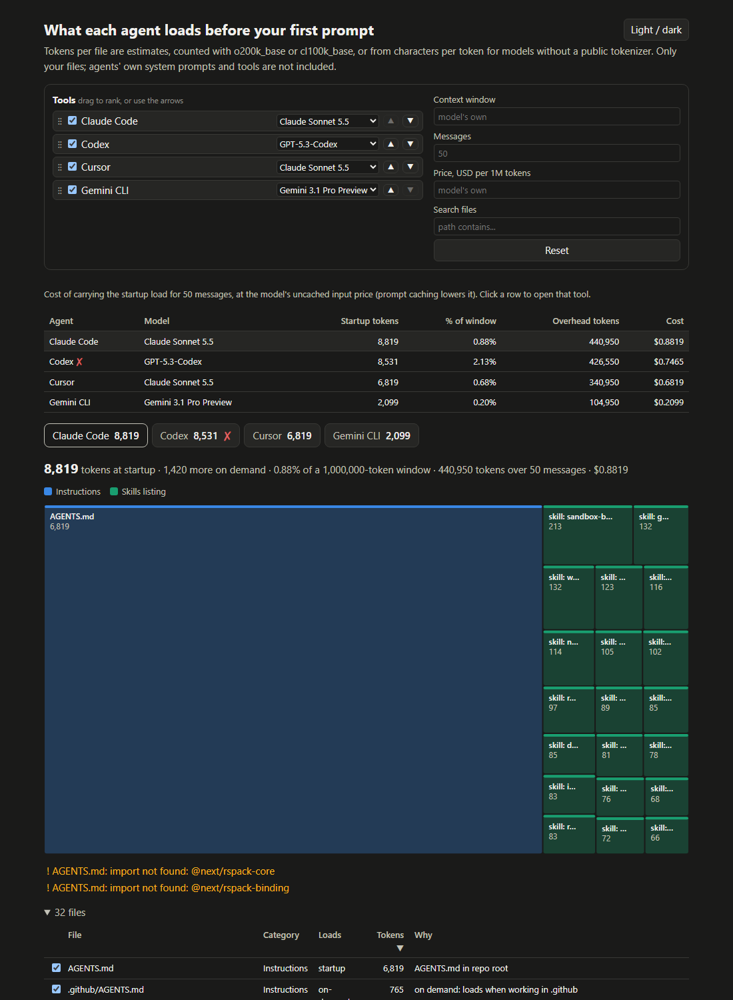

# ctxsize




Coding agents read your instruction files and skills before you type anything. That costs tokens on every message, and each agent silently cuts off what is too big.
`ctxsize` shows what each agent loads, what it costs, and what gets dropped. It never runs an agent and never uses the network.

> **Not published to npm yet.** For now, run it from a clone (see [Development](#development)).

## Install

```sh
npx ctxsize            # once it is on npm: no install needed
npm install -g ctxsize # or keep it
```

Needs Node 22.12 or newer.

## Three examples

**1. See the load.** Run it in any repo. Real output on [vercel/next.js](https://github.com/vercel/next.js):

```sh
npx ctxsize
```

```text
  Agent        Instructions  Rules  Skills  Startup  % ctx   On demand
  Claude Code         6,819      0   2,000    8,819   0.9%  1,420 (10)
  Codex               6,819      0   1,712    8,531   2.1%           0
  Cursor              6,819      0       0    6,819   0.7%   1,410 (8)
  Gemini CLI              0      0   2,099    2,099   0.2%           0

Cost of carrying it
  Agent        Model                    Window  Per message  50 messages     Cost
  Claude Code  Claude Sonnet 5.5*           1M        8,819      440,950  $0.8819
  Codex        GPT-5.3-Codex*             400k        8,531      426,550  $0.7465
```

"Startup" is what loads before your first prompt. "On demand" loads later, only when needed.
The cost is startup tokens times 50 messages, at the model's uncached input price.

**2. Fail CI when it grows too big.**

```sh
npx ctxsize --agents claude,codex --max-tokens 8600
```

```text
ctxsize: Claude Code loads 8,819 tokens at startup, over --max-tokens 8,600
```

The exit code is `1`, so the CI job fails.

**3. Open an interactive report, or comment on a pull request.**

```sh
npx ctxsize --html                      # writes ctxsize-report.html
npx ctxsize --markdown summary.md       # a table for a PR comment
```

The HTML page lets you switch model, window and price, untick files to see "what if I removed this", reorder and sort tools, search files, and switch to dark mode.

## Features

| Feature | How |
| --- | --- |
| 10 built-in tools: Claude Code, Codex, Cursor, GitHub Copilot, Gemini CLI, OpenCode, Cline, Windsurf, Aider, Zed | `--agents claude,codex` |
| Your own tools | `ctxsize.json` ([CONFIG](docs/CONFIG.md)) |
| Model, context window, tokenizer and price per tool | `--model`, `--context`, `--price` |
| Share of the window, cost over N messages | `--messages 80` |
| Biggest files | in every report |
| What each agent drops or may drop (with the docs link) | in every report |
| Duplicate instructions and skill health checks | on by default, `--no-checks` to skip |
| List every documented agent limit with its source and checked date | `--check-profiles` |
| Interactive HTML report | `--html` |
| Compare with another commit | `--diff main` |
| Trend over the last commits | `--history 20` (add `--html` for a chart) |
| Re-run when files change | `--watch` |
| Startup load per nested folder (monorepos) | `--tree` |
| MCP servers (count their tool tokens) | `--mcp` (runs the configured commands) |
| Pull request summary, SVG card, README badge | `--markdown`, `--card`, `--badge` |
| CI gate | `--max-tokens 10000` |
| JSON output | `--json` |

New here? Read the [5-minute walkthrough](docs/GETTING-STARTED.md). What each tool reads: [docs/tools.md](docs/tools.md).

## Config

Optional. Put a `ctxsize.json` in the repo root:

```json
{
  "messages": 80,
  "tools": {
    "claude": { "model": "claude-haiku-5-5" },
    "acme": {
      "label": "Acme Agent",
      "instructions": ["ACME.md"],
      "skills": { "dirs": [".acme/skills"] }
    }
  }
}
```

Every option is in [docs/CONFIG.md](docs/CONFIG.md).

## FAQ

**Are the numbers exact?** No. They are estimates. Each provider counts tokens its own way, and ctxsize does not call any API.

**Does it send my files anywhere?** No. It makes no network calls.

**Does it run my agents?** No. It reads files and applies the limits from each tool's public docs.

**Where do the limits come from?** [`src/profiles.ts`](src/profiles.ts). Each limit has a docs link and the date it was last checked. If a doc says nothing, ctxsize says "not documented" instead of guessing.

**Does it read my home folder?** Only with `--include-user`.

**Does it work on Windows?** Yes. CI runs on Linux, macOS and Windows. Paths in reports always use `/`.

**What does `--mcp` run?** The local MCP server commands in the repo's config. Use it only on repos you trust.

**What does `*` after a model mean?** ctxsize picked that model for you. Choose one with `--model`.

## Development

```sh
npm ci
npm run check   # lint, typecheck, test, build
npm run dev -- path/to/repo
```

See [CONTRIBUTING.md](CONTRIBUTING.md). MIT licensed.
