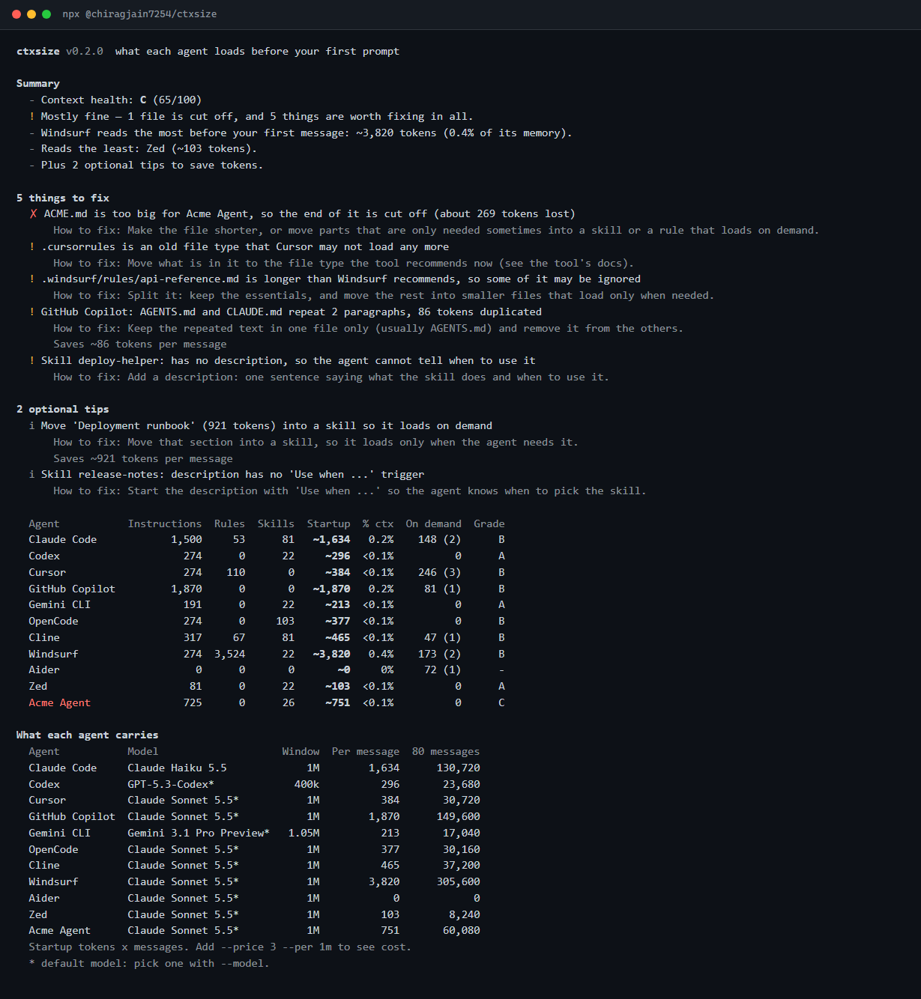
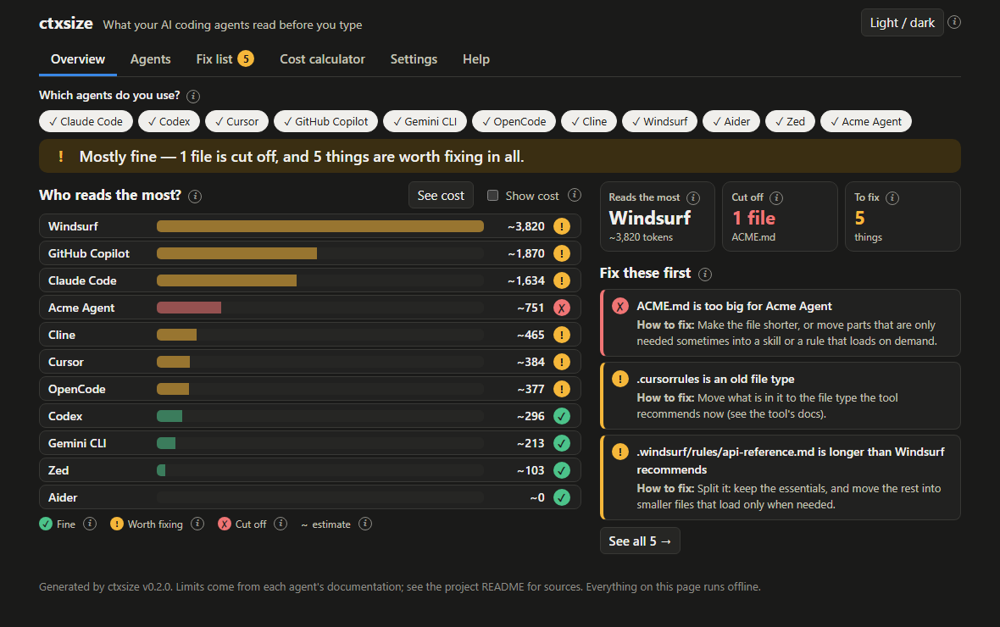
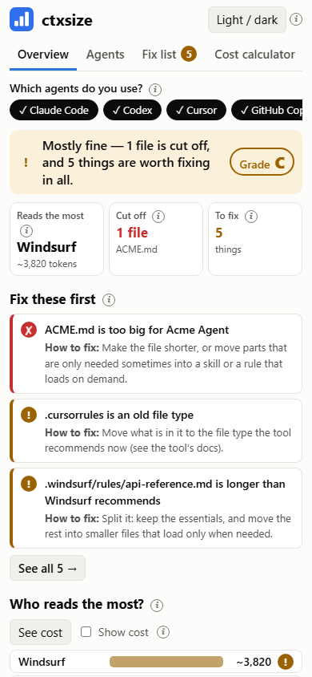
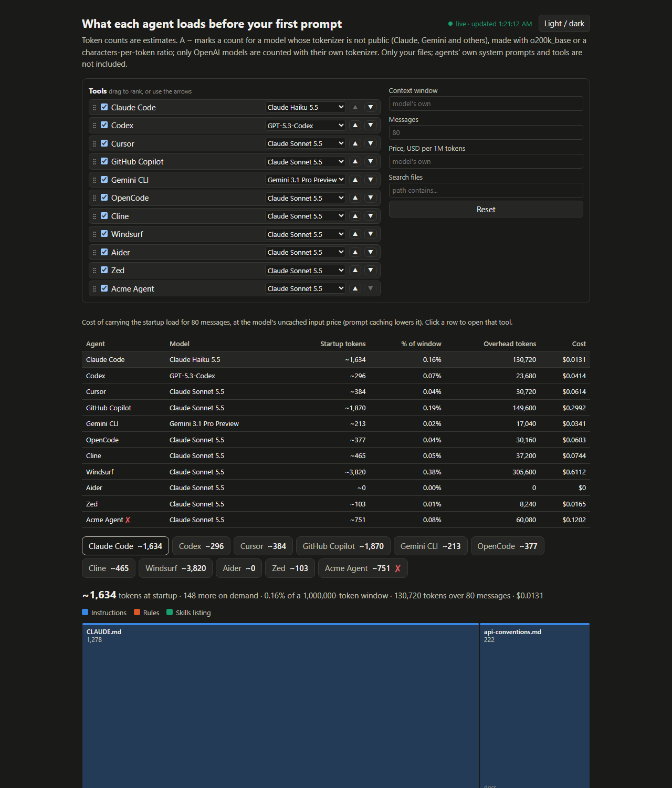
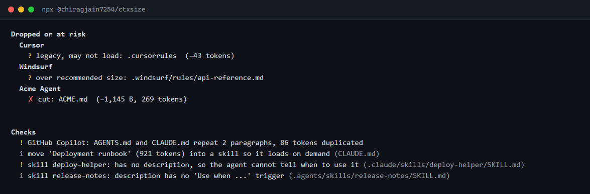
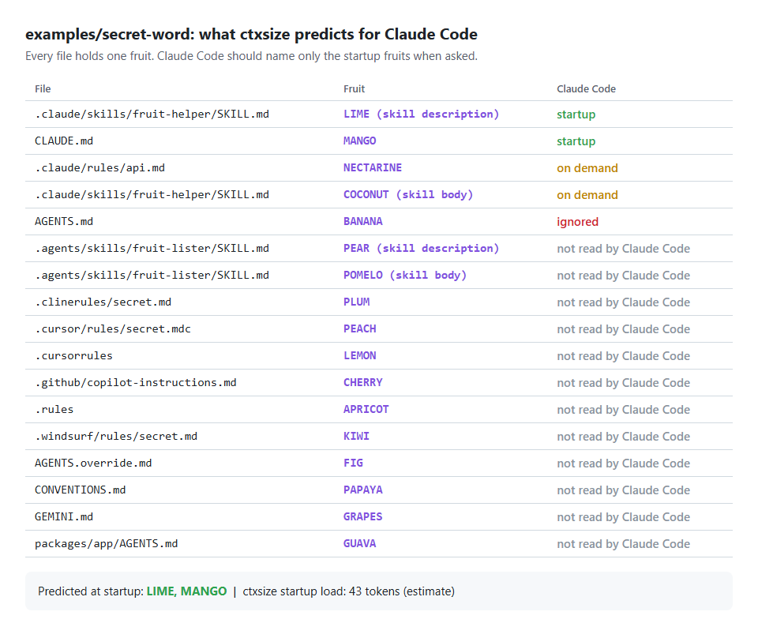
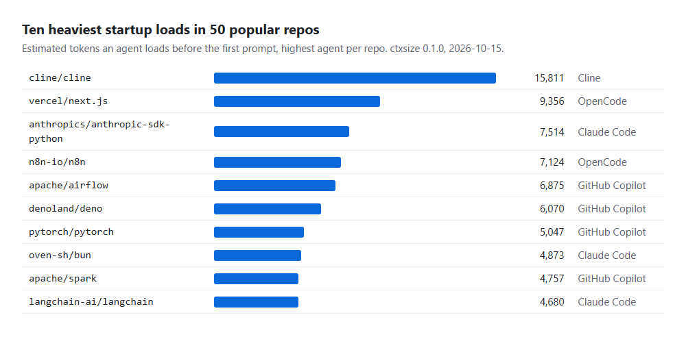

# What ctxsize can do

## The features

| Feature | How |
| --- | --- |
| Tools with no files are hidden by default | `--all` shows them |
| 10 built-in tools: Claude Code, Codex, Cursor, GitHub Copilot, Gemini CLI, OpenCode, Cline, Windsurf, Aider, Zed | `--agents claude,codex` |
| Your own tools | `ctxsize.json` ([CONFIG](CONFIG.md)) |
| Model, context window and tokenizer per tool | `--model`, `--context` |
| Share of the window, tokens over N messages | `--messages 80` |
| Cost, with your own price (ctxsize has none) | `--price 3 --per 1m --currency $` |
| Biggest files | in every report |
| What each agent drops or may drop (with the docs link) | in every report |
| Duplicate instructions and skill health checks | on by default, `--no-checks` to skip |
| List every documented agent limit with its source and checked date | `--check-profiles` |
| Interactive HTML report | `--html` |
| Compare with another commit | `--diff main` |
| Trend over the last commits | `--history 20` (add `--html` for a chart) |
| Re-run when files change | `--watch` |
| Live report in your browser | `--serve` (`--port`, `--no-open`) |
| Startup load per nested folder (monorepos) | `--tree` |
| MCP servers (count their tool tokens) | `--mcp` (runs the configured commands) |
| Pull request summary, SVG card, README badge | `--markdown`, `--card`, `--badge` |
| CI gate | `--max-tokens 10000` |
| JSON output | `--json` |

Every flag is in [CLI.md](CLI.md). New here? Start with [GETTING-STARTED.md](GETTING-STARTED.md), and read the [glossary](GLOSSARY.md) for the words used in the report.

## Three ways to look at the result

```sh
npx @chiragjain7254/ctxsize                      # a summary in your terminal
npx @chiragjain7254/ctxsize --html --open        # an interactive page (writes ctxsize-report.html)
npx @chiragjain7254/ctxsize --serve              # the same page, live: http://localhost:4321
```

The page has six tabs: **Overview** (the answer on one screen), **Agents** (what each one reads and how to read less), **Fix list**, **Cost calculator** (type your own price and see the cost per message, per day and per month, or compare two prices), **Settings** (what if: another model or window) and **Help**. Click the agents you use at the top of the Overview and everything counts only those.

`--serve` listens on `127.0.0.1` only. `http://localhost:<port>/api/report` returns the same JSON as `--json`. Press Ctrl+C to stop.

## Screenshots

**The terminal.** The summary first, then the fixes, then the tables.



**The page in dark mode.** Light and dark follow your system, with a switch on the page.



**On a phone.** The same page at 390 px wide: the fixes come before the chart.



**The live page** (`--serve`) updates as you edit your instruction files.



**What gets dropped, and what to fix.** The "Dropped or at risk" and "Checks" sections of the terminal report up close.



**The secret-word test.** Every file in `examples/secret-word` holds one fruit, and this is what ctxsize predicts Claude Code knows. [Check it on the real agent](VERIFY.md).



**The 50-repo study.** The ten heaviest startup loads. [Full study](STUDY.md).


